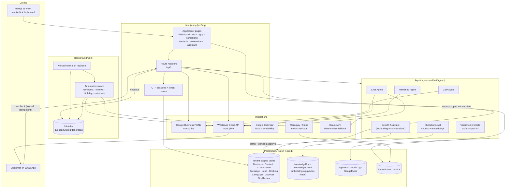
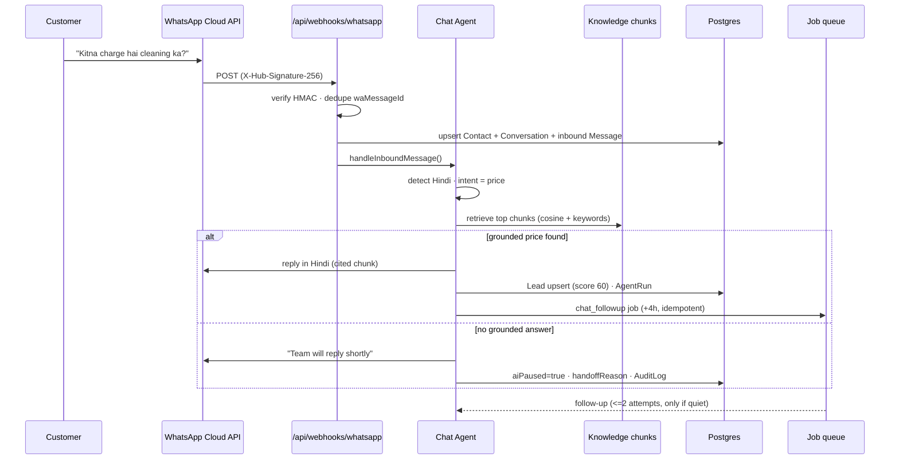

# GrowBuff architecture

## Goals

1. One tenant-scoped backend that a non-technical owner can drive entirely from a phone.
2. Customer-facing actions are **approval-first** and grounded; uncertainty always becomes a human handoff.
3. Google and WhatsApp can be swapped between sandbox and live without touching agent logic.
4. Every AI action, admin access and opt-out is auditable.

## System map

## Request flow: a customer WhatsApp message

## Tenancy and isolation

- Every tenant-owned model has `tenantId` plus composite indexes.
- UI/API code uses `db(tenantId)` from `src/lib/db.ts`. It is a Prisma client extension that:
  - injects `tenantId` into every `where`, `data` and `create`, and
  - rewrites `findUnique` into a tenant-filtered `findFirst`.
- Any query on a tenant model without a tenant context throws.
- Auth/webhook/admin paths intentionally use `unscoped` and are narrowly audited.
- Admin impersonation writes a `gb_tenant` cookie after checking `isAdmin` and records `admin.impersonation_started`.
- Production hardening: add Postgres RLS keyed on a session GUC as a second layer.

## Knowledge base / RAG

1. Onboarding facts (about, services/prices, hours/location, FAQs, safety policy) are composed into `KnowledgeDoc`s.
2. Documents are chunked with overlap and each chunk gets:
   - `keywords` for lexical matching, and
   - a deterministic local 256-dim hashed embedding (`Float[]`).
3. Retrieval scores `0.55 * cosine + 0.45 * token-overlap + keyword boost`; below `0.16` ⇒ no answer ⇒ handoff.
4. Edits re-chunk and re-embed immediately; chat messages show the source document title.
5. **Upgrade path:** pgvector is installed in the local image (`docker/init.sql`). Add a real embedding model, store `vector(1024)`, create an HNSW index, and replace the in-app ranking with a `<=>` query; the retrieval interface stays the same.
6. Prompt rules forbid invented prices/availability, medical/legal advice, and answering without context. Code adds independent guardrails (regex topics, price grounding, usage limits) so a model failure cannot bypass them.

## Queues and failure handling

- `Job` rows are typed (`glyph` list in `src/lib/jobs/queue.ts`), carry tenant + JSON payload, optional `idempotencyKey` (unique), `runAt`, `attempts`, `maxAttempts`.
- Claiming uses `updateMany where status=queued` so concurrent workers cannot double-process.
- Failures: exponential backoff (2^attempt minutes, max 30); after max attempts → `dead` + audit entry. Admin panel lists dead jobs.
- Idempotency: webhook `waMessageId` uniqueness, job idempotency keys (reminders, review requests, campaign sends, daily automation sweeps).
- Campaign delivery re-checks opt-in, plan quota and template approval per recipient; failures are recorded per recipient.
- Live WhatsApp sends enforce the 24-hour session window and refuse free-form business-initiated messages without a template.
- Transport can be swapped to Redis/BullMQ; handlers receive the same payloads.

## AI safety and approvals

| Control | Implementation |
| --- | --- |
| Grounding only | Retrieval threshold → handoff; price answers require a price token in context; no answer when knowledge is empty. |
| Human handoff | Complaints, medical/legal/emergency keywords, low confidence, usage limits, explicit human request → `aiPaused` + reason + audit. |
| No medical/legal advice | Prompt rule + deterministic guardrail regex before generation. |
| Approval-first | GBP posts, negative review replies and campaigns are stored as `pending_approval`; assistant actions store an `AgentRun` with `pending_approval` and require confirmation. |
| Audit | `AgentRun` (input/output/model/tokens/approval) + `AuditLog` (human, AI, admin, system). |
| Compliance | Opt-in required for marketing; STOP/START handled; approved templates only outside the session window; opt-out state checked at send time. |

## Cost / scale notes

- Chat replies are short and grounded; retrieval caps at 500 chunks per tenant in the MVP, which should become a pgvector ANN query per tenant.
- Usage metering (`UsageEvent`) already gates each agent plan.
- Model calls run in the request path for chat; move to an async responder if latency budgets demand it (queue + webhook callback).
- Google/WhatsApp adapters are isolated so retries, rate limiting and circuit breakers can live inside them.
